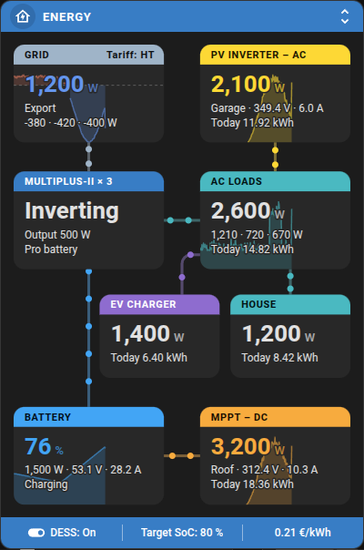
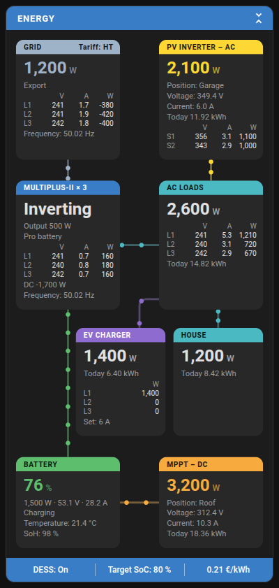
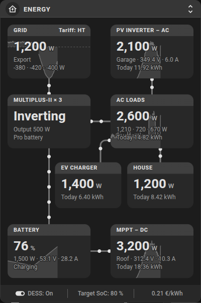
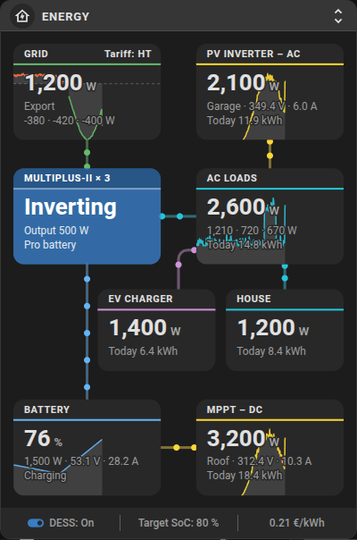
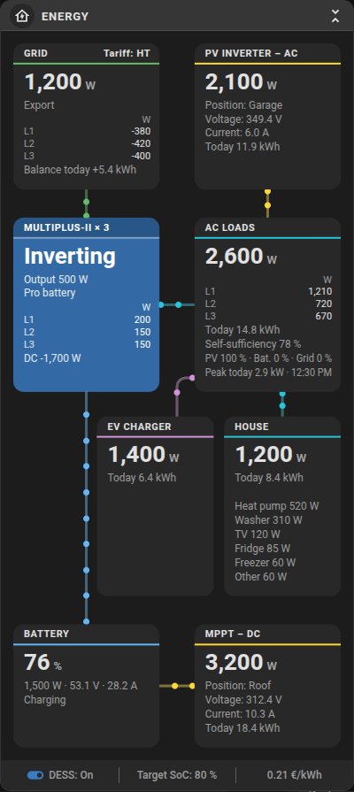

# Victron ESS Flow Card

Animated energy-flow card for Home Assistant, made for Victron ESS systems
(MultiPlus / Quattro with a battery, MPPT chargers and AC-coupled PV inverters).

 

*Compact view with today's graphs and the footer · detailed view (sample data)*

The diagram follows how such a system is actually wired:

```
Grid ──── Inverter/charger ──── AC loads ──── AC-coupled PV
               │
            Battery ──── DC-coupled PV (MPPT)
```

- Lines run the full length between boxes; moving dots show direction, their speed follows the power.
- Portrait (2 × 3) or landscape (3 × 2) layout, switched automatically by card width (≥ 560 px → landscape).
- Colors follow your Home Assistant theme; texts in English or Slovak (by HA language).
- Three color modes: colored, monochrome (shades of gray from the theme) and accent (gray surfaces with energy colors
  as accents) — see [Color modes](#color-modes).
- Every value is a single entity or a list of entities (e.g. three phases), which are summed.
- Tap a box to open the more-info dialog.
- Compact or detailed view (per-phase V · A · W tables, PV strings, extra lines), switched by an icon in the card header.
- Optional background graphs of today (PV, loads, grid import / export, battery SoC).
- Footer chips (e.g. a Dynamic ESS switch, target SoC, price) and alerts that turn a box header red.
- Plain JavaScript, no dependencies, no build step.

## Installation

### Marketplace (custom repository)

1. In Home Assistant open **Marketplace → ⋮ → Custom repositories**.
2. Add `https://github.com/CVKBaca/victron-ess-flow-card`, category **Dashboard** (plugin).
3. Install **Victron ESS Flow Card** and reload the browser.

### Manual

1. Copy `victron-ess-flow-card.js` to `<config>/www/`.
2. Add a dashboard resource: URL `/local/victron-ess-flow-card.js`, type **JavaScript module**.

## Minimal configuration

```yaml
type: custom:victron-ess-flow-card
grid:
  power: sensor.grid_net_power
inverter:
  state: sensor.vebus_state
loads:
  power: sensor.ac_loads_power
battery:
  power: sensor.battery_power
  soc: sensor.battery_soc
```

## Full example

```yaml
type: custom:victron-ess-flow-card
title: Energy
grid:
  power: [sensor.grid_power_l1, sensor.grid_power_l2, sensor.grid_power_l3]
  extra:
    - entity: sensor.electricity_tariff
      name: Tariff
inverter:
  name: MultiPlus-II
  state: sensor.vebus_state
  power: [sensor.inverter_output_l1_power, sensor.inverter_output_l2_power, sensor.inverter_output_l3_power]
  dc_power: sensor.vebus_dc_power
  mode: sensor.ess_operating_mode
loads:
  power: [sensor.ac_loads_l1_power, sensor.ac_loads_l2_power, sensor.ac_loads_l3_power]
  today: sensor.ac_loads_energy_today
  consumers:
    - name: EV charger
      power: sensor.ev_charger_power
      today: sensor.ev_charger_energy_today
      color: '#8E6CCF'
    - name: House          # no power -> the rest (loads − other consumers)
battery:
  power: sensor.battery_power
  soc: sensor.battery_soc
  voltage: sensor.battery_voltage
  current: sensor.battery_current
dc_sources:
  - name: Roof
    power: sensor.mppt_pv_power
    today: sensor.mppt_yield_today
    voltage: sensor.mppt_pv_voltage
    current: sensor.mppt_pv_current
ac_sources:
  - name: Garage
    power: sensor.pv_inverter_power
    today: sensor.pv_inverter_yield_today
    voltage: [sensor.pv_inverter_string1_voltage, sensor.pv_inverter_string2_voltage]
    current: [sensor.pv_inverter_string1_current, sensor.pv_inverter_string2_current]
dc_label: Solar DC
ac_label: Solar AC
```

## Options

### Card

| Option | Default | Description |
|---|---|---|
| `title` | – | Card title, shown in the card header (styled like the box headers, `header_style` applies) left of the view toggle |
| `layout` | `auto` | `auto`, `portrait` or `landscape` |
| `scale` | `fit` | `fit` = the drawing is scaled to the card width (texts grow with wide cards); `native` = drawn 1:1 at the card width, so texts keep the sizes of other cards (11 / 26 / 12 px) and the boxes get wider instead |
| `min_flow` | `10` | Below this power (W) a line is shown as idle |
| `header_style` | `bar` | `bar` = colored header bar with the box title, `stripe` = colored stripe on the left |
| `color_mode` | `color` | `color` = colored boxes, flows and graphs; `mono` = shades of the theme text color only; `accent` = mono with energy colors as accents (see [Color modes](#color-modes)) |
| `icon` | – | Icon in a circle left of the card title, e.g. `mdi:home-lightning-bolt-outline` |
| `tint` | – | `mono` / `accent`: accent color per box: `{grid, inverter, loads, battery, dc, ac, import, export}` (`import` / `export` color the grid by the direction); consumers have their own `tint` |
| `tint_style` | `header` | `mono` / `accent` (`accent` default `line`): `header` = a soft wash of the tint in the box header, `line` = only a line under the box title |
| `tint_header` | – | Header wash color per box instead of the tint (e.g. amber for PV: a dimmed yellow turns olive) |
| `tint_header_opacity` | `0.2` | Strength of the header wash |
| `fill` | – | `mono` / `accent`: boxes drawn filled in their tint with white texts, e.g. `[inverter]` (`accent` default) |
| `fill_opacity` | `1` | Opacity of the filled boxes (`accent` default `0.8`) |
| `energy_decimals` | `2` | Decimals of today's kWh values |
| `colors` | built-in | Override colors (`color_mode: color`): `grid`, `import`, `export`, `inverter`, `loads`, `battery`, `dc`, `ac`, `header` (card header). Title text colors: `header_text`, `grid_text`, `inverter_text`, `loads_text`, `battery_text`, `dc_text`, `ac_text` (default: white, dark on light colors). Graph colors: `grid_graph`, `loads_graph`, `battery_graph`, `dc_graph`, `ac_graph` (default: the box color; grid: `import` / `export`) |
| `dc_label` | `Solar DC` | Title of the DC-coupled PV box |
| `ac_label` | `Solar AC` | Title of the AC-coupled PV box |
| `graphs` | – | Background graphs of today (from 00:00) in the boxes: list of `dc`, `ac`, `battery`, `loads`, `grid` (see [Graphs](#graphs)) |
| `graphs_view` | `compact` | View with graphs: `compact`, `detail` or `both` |
| `footer` | – | Bar at the bottom in the style of the header, split into equal parts: list of `{entity, name, icon, unit}` (`name: ''` = value only); value formatted by HA, tap opens more-info (e.g. a switch with its toggle) |
| `view` | `compact` | `compact` or `detail` (see [Detailed view](#detailed-view)) |
| `view_toggle` | `true` | Icon in the card header (right) switching the view; the choice is remembered per device (browser) and wins over `view`. `false` = always `view` |

### Sections

Common options for `grid`, `inverter`, `loads` and `battery`:

| Option | Description |
|---|---|
| `name` | Box title |
| `invert` | `true` flips the sign of `power` |
| `extra` | Extra lines: list of `{entity, name, unit}`; value formatted by HA (translated states, display precision) unless `unit` is given |
| `header_extra` | Values in the box header, right-aligned (e.g. tariff); the box title gets the room left of them: list of `{entity, name, unit}`; also for consumers |
| `tap_entity` | Entity opened on tap (default: the main entity of the box) |
| `alert` | `{entity, ok, text, text_entity}`: while `entity` is not in `ok` (a value or a list; `unknown` / `unavailable` are ignored) the box header turns red and shows the alert text (`text_entity` formatted, else `text`, else the state); also for consumers |

| Section | Option | Required | Description |
|---|---|---|---|
| `grid` | `power` | yes | Grid power, + = import (entity or list of phases) |
| | `balance` | – | `{import, export}` today's kWh → detailed view line `Balance today ±x kWh` (export − import) |
| `inverter` | `state` | – | Inverter state shown as the main value (e.g. Bulk, Inverting); VE.Bus states (English text or numeric code) are translated to the HA language |
| | `power` | – | AC output power (entity or list); if missing, computed as loads − AC PV |
| | `dc_power` | – | DC power of the inverter, + = charging the battery; if missing, computed as battery − DC PV |
| | `invert_dc` | – | `true` flips the sign of `dc_power` |
| | `mode` | – | Extra line with a mode / strategy entity |
| `loads` | `power` | yes | AC loads power (entity or list) |
| | `today` | – | Today's energy (kWh), shown as a line in the box |
| | `consumers` | – | Boxes fed from the AC loads, each with its own animated line (see below) |
| | `details` | – | Extra lines: list of `{name, power}` |
| | `self_sufficiency` | – | `{import}` today's grid import (kWh) → detailed view line `Self-sufficiency x %` (1 − import / `today`) |
| | `sources` | – | `true` → detailed view line `PV x % · Bat. y % · Grid z %`: where the loads come from now (AC-coupled PV first, then the inverter output split by the VE.Bus DC flow: MPPT, battery, grid pass-through) |
| | `peak` | – | `true` → detailed view line `Peak today x kW · HH:MM` (highest 5-minute mean since midnight; needs `graphs: [loads]`) |
| `battery` | `power` | – | Battery power, + = charging |
| | `soc` | – | State of charge (%) — main value |
| | `voltage`, `current` | – | Shown next to the power |
| | `state` | – | Entity shown instead of Charging / Discharging |

`dc_sources` and `ac_sources` are lists of PV sources. Each item is an entity id or
`{name, power, today, voltage, current}` (`power` may be a list, `today` is the daily yield in kWh,
`voltage` / `current` are PV values: a list of strings is averaged / summed).
Sources are summed in one box. With one source the power is the big value and the box shows
`name · V · A` and `Today … kWh` (detailed view: one line each — `Position: name`, `Voltage`, `Current`, `Today`); with more sources each source gets its own line (`name power · today`).

`loads.consumers` is a list of boxes fed from the AC loads (e.g. EV charger, house). Each item:
`name`, `power` (entity or list), `today` (kWh), `color`, `text_color` (box title), `tint` (mono / accent), `extra`,
`tap_entity`, `top` (see below).
The first consumer **without `power`** shows the rest: loads − other consumers (and, if it has no `today` but
`loads.today` is set, loads today − other consumers today).
Portrait: consumers sit side by side under the AC loads box (two per row); the last one is right under it.
Landscape: consumers are stacked in a 4th column.

A consumer's `top: {entities: [{entity, name}], count: 5, min: 5}` lists the biggest measured loads now in the detailed
view: always `count` lines sorted by power (below `min` W left out, so the box height stays), then `Other` = the box
power minus all measured loads.

Power entities may be in W or kW (converted by `unit_of_measurement`).

### Graphs

`graphs: [dc, ac, battery, loads, grid]` draws today's curve (00:00 – now, 5-minute averages) behind the box content:
PV boxes the sum of the sources' power and the AC loads box the sum of its `power` entities (scaled to today's maximum),
the battery box the state of charge (0–100 %), the grid box import above and export below a zero line
(colors `import` / `export`; the zero line sits by today's maximum import vs. export).
Today's data come from the recorder's 5-minute statistics (entities with a `state_class`; others fall back to the
state history, which is much larger) and are then extended with live values; after a longer pause
(e.g. a phone asleep) it is reloaded. By default graphs are shown in the compact view only (`graphs_view`),
the detailed view keeps its numbers readable.

```yaml
graphs: [dc, ac, battery, loads, grid]
```

### Footer and alerts

A footer item with a `switch` or `input_boolean` (and no own `icon`) shows a toggle icon with its state, so it reads as
an action; tap opens more-info with the toggle (no switching by an accidental tap while scrolling).

```yaml
footer:
  - entity: switch.dess_enabled
    name: DESS
  - entity: sensor.dess_slot_target_soc
    name: Target SoC
grid:
  power: sensor.grid_net_power
  alert:
    entity: sensor.grid_status
    ok: 'OK'
    text: Grid lost
inverter:
  state: sensor.vebus_state
  alert:
    entity: sensor.dess_error_code
    ok: '0'
    text_entity: sensor.dess_error_text
```

### Detailed view

The detailed view keeps the compact content and adds rows below it (boxes get taller, lines follow).
All options are optional and are shown only in the detailed view:

| Where | Option | Description |
|---|---|---|
| `grid`, `inverter`, `loads`, consumers | `voltage`, `current` | Lists of phase entities → table `L1…Ln` with V · A · W (W from the `power` list) |
| any section, consumers | `phase_power` | Per-phase power for the table when `power` is a single total entity |
| PV source | `strings` | List of `{name, voltage, current, power}` → table per string (`S1`, `S2`, … if no name) |
| everywhere (sections, PV sources, consumers) | `detail` | Extra lines: list of `{entity, name, unit}`; value formatted by HA |

The inverter also shows its `dc_power` as a `DC … W` line.

```yaml
grid:
  power: [sensor.grid_power_l1, sensor.grid_power_l2, sensor.grid_power_l3]
  voltage: [sensor.grid_voltage_l1, sensor.grid_voltage_l2, sensor.grid_voltage_l3]
  current: [sensor.grid_current_l1, sensor.grid_current_l2, sensor.grid_current_l3]
  detail:
    - entity: sensor.grid_meter_frequency
      name: Frequency
battery:
  power: sensor.battery_power
  soc: sensor.battery_soc
  detail:
    - entity: sensor.battery_temperature
      name: Temperature
    - entity: sensor.battery_soh
      name: SoH
ac_sources:
  - name: Garage
    power: sensor.pv_inverter_power
    strings:
      - {voltage: sensor.pv_string1_voltage, current: sensor.pv_string1_current, power: sensor.pv_string1_power}
      - {voltage: sensor.pv_string2_voltage, current: sensor.pv_string2_current, power: sensor.pv_string2_power}
loads:
  power: sensor.ac_loads_power
  consumers:
    - name: EV charger
      power: sensor.ev_charger_power
      phase_power: [sensor.ev_charger_power_l1, sensor.ev_charger_power_l2, sensor.ev_charger_power_l3]
      detail:
        - entity: sensor.ev_charger_set_current
          name: Set
```

### Color modes

  

*`color` · `mono` · `accent` (sample data)*

**`color`** (default) — colored box headers, flows and graphs (`colors` to change them).

**`mono`** — shades of the theme text color, for calm dashboards:

- card header: flat light gray (12 % of the text color) with a divider line; footer: plain secondary background with
  gray text
- boxes: header bar in the same gray with a divider line (with `header_style: stripe` a gray stripe on the left instead)
- values, flow lines, moving dots and background graphs in gray; small lines in the secondary text color
- alerts stay red
- `tint` adds a color to single boxes (title wash or line, flows and graph line in that color)

**`accent`** — `mono` with a palette of energy colors commonly used in the community, as accents on gray surfaces:
PV yellow `#FDD835`, battery blue `#64B5F6`, inverter Victron blue `#387DC5` (filled box, `fill_opacity` 0.8),
grid import red-orange `#FF7043` / export green `#66BB6A` (the grid box follows the direction), loads and
consumers cyan `#26C6DA`. A colored line under each box title, the flows and dots in the color of the energy
flowing, graphs with a gray area and a colored line; values stay white. Any color can be changed with `tint`.



*`accent`, detailed view with `top` loads, `grid.balance`, `loads.self_sufficiency`, `sources` and `peak`*

The shades are derived from `--primary-text-color` / `--secondary-text-color`, so `mono` and `accent` work with light
and dark themes. Texts over the graphs get a halo in the box color, so they stay readable.

With `scale: native` the boxes also match the size of text in tiles built with other cards (e.g. button-card):

```yaml
type: custom:victron-ess-flow-card
color_mode: accent
scale: native
icon: mdi:home-lightning-bolt-outline
tint:
  battery: '#42A5F5'   # optional: a different battery blue
```

## Credits

Inspired by [victron-solar-cards](https://github.com/ossilampe/victron-solar-cards) by ossilampe.
This card is an independent implementation.

## License

MIT
