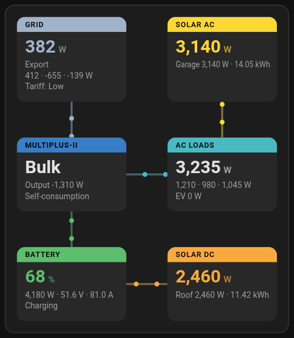

# Victron ESS Flow Card

Animated energy-flow card for Home Assistant, made for Victron ESS systems
(MultiPlus / Quattro with a battery, MPPT chargers and AC-coupled PV inverters).



The diagram follows how such a system is actually wired:

```
Grid ──── Inverter/charger ──── AC loads ──── AC-coupled PV
               │
            Battery ──── DC-coupled PV (MPPT)
```

- Lines run the full length between boxes; moving dots show direction, their speed follows the power.
- Portrait (2 × 3) or landscape (3 × 2) layout, switched automatically by card width (≥ 560 px → landscape).
- Colors follow your Home Assistant theme; texts in English or Slovak (by HA language).
- Every value is a single entity or a list of entities (e.g. three phases), which are summed.
- Tap a box to open the more-info dialog.
- Plain JavaScript, no dependencies, no build step.

## Installation

### Marketplace (custom repository)

1. In Home Assistant open **Marketplace → ⋮ → Custom repositories**.
2. Add `https://github.com/CVKBaca/victron-ess-flow-card`, category **Dashboard** (plugin).
3. Install **Victron ESS Flow Card** and reload the browser.

### Manual

1. Copy `victron-ess-flow-card.js` to `<config>/www/`.
2. Add a dashboard resource: URL `/local/victron-ess-flow-card.js`, type **JavaScript module**.

## Minimal configuration

```yaml
type: custom:victron-ess-flow-card
grid:
  power: sensor.grid_power
inverter:
  state: sensor.vebus_state
loads:
  power: sensor.ac_loads_power
battery:
  power: sensor.battery_power
  soc: sensor.battery_soc
```

## Full example

```yaml
type: custom:victron-ess-flow-card
title: Energy
grid:
  power: [sensor.grid_l1_power, sensor.grid_l2_power, sensor.grid_l3_power]
  extra:
    - entity: sensor.electricity_tariff
      name: Tariff
inverter:
  name: MultiPlus-II
  state: sensor.vebus_state
  power: [sensor.inverter_output_l1_power, sensor.inverter_output_l2_power, sensor.inverter_output_l3_power]
  dc_power: sensor.vebus_dc_power
  mode: sensor.ess_mode
loads:
  power: [sensor.ac_loads_l1_power, sensor.ac_loads_l2_power, sensor.ac_loads_l3_power]
  today: sensor.ac_loads_energy_today
  consumers:
    - name: EV charger
      power: sensor.ev_charger_power
      today: sensor.ev_charger_energy_today
      color: '#8E6CCF'
    - name: House          # no power -> the rest (loads − other consumers)
battery:
  power: sensor.battery_power
  soc: sensor.battery_soc
  voltage: sensor.battery_voltage
  current: sensor.battery_current
dc_sources:
  - name: Roof
    power: sensor.mppt_pv_power
    today: sensor.mppt_yield_today
    voltage: sensor.mppt_pv_voltage
    current: sensor.mppt_pv_current
ac_sources:
  - name: Garage
    power: sensor.pv_inverter_power
    today: sensor.pv_inverter_yield_today
    voltage: [sensor.pv_inverter_string1_voltage, sensor.pv_inverter_string2_voltage]
    current: [sensor.pv_inverter_string1_current, sensor.pv_inverter_string2_current]
dc_label: Solar DC
ac_label: Solar AC
```

## Options

### Card

| Option | Default | Description |
|---|---|---|
| `title` | – | Card title |
| `layout` | `auto` | `auto`, `portrait` or `landscape` |
| `min_flow` | `10` | Below this power (W) a line is shown as idle |
| `header_style` | `bar` | `bar` = colored header bar with the box title, `stripe` = colored stripe on the left |
| `colors` | built-in | Override colors: `grid`, `import`, `export`, `inverter`, `loads`, `battery`, `dc`, `ac` |
| `dc_label` | `Solar DC` | Title of the DC-coupled PV box |
| `ac_label` | `Solar AC` | Title of the AC-coupled PV box |

### Sections

Common options for `grid`, `inverter`, `loads` and `battery`:

| Option | Description |
|---|---|
| `name` | Box title |
| `invert` | `true` flips the sign of `power` |
| `extra` | Extra lines: list of `{entity, name, unit}` |
| `tap_entity` | Entity opened on tap (default: the main entity of the box) |

| Section | Option | Required | Description |
|---|---|---|---|
| `grid` | `power` | yes | Grid power, + = import (entity or list of phases) |
| `inverter` | `state` | – | Inverter state shown as the main value (e.g. Bulk, Inverting); VE.Bus states (English text or numeric code) are translated to the HA language |
| | `power` | – | AC output power (entity or list); if missing, computed as loads − AC PV |
| | `dc_power` | – | DC power of the inverter, + = charging the battery; if missing, computed as battery − DC PV |
| | `invert_dc` | – | `true` flips the sign of `dc_power` |
| | `mode` | – | Extra line with a mode / strategy entity |
| `loads` | `power` | yes | AC loads power (entity or list) |
| | `today` | – | Today's energy (kWh), shown as a line in the box |
| | `consumers` | – | Boxes fed from the AC loads, each with its own animated line (see below) |
| | `details` | – | Extra lines: list of `{name, power}` |
| `battery` | `power` | – | Battery power, + = charging |
| | `soc` | – | State of charge (%) — main value |
| | `voltage`, `current` | – | Shown next to the power |
| | `state` | – | Entity shown instead of Charging / Discharging |

`dc_sources` and `ac_sources` are lists of PV sources. Each item is an entity id or
`{name, power, today, voltage, current}` (`power` may be a list, `today` is the daily yield in kWh,
`voltage` / `current` are PV values: a list of strings is averaged / summed).
Sources are summed in one box. With one source the power is the big value and the box shows
`name · V · A` and `Today … kWh`; with more sources each source gets its own line (`name power · today`).

`loads.consumers` is a list of boxes fed from the AC loads (e.g. EV charger, house). Each item:
`name`, `power` (entity or list), `today` (kWh), `color`, `extra`, `tap_entity`.
The first consumer **without `power`** shows the rest: loads − other consumers (and, if it has no `today` but
`loads.today` is set, loads today − other consumers today).
Portrait: consumers sit side by side under the AC loads box (two per row); the last one is right under it.
Landscape: consumers are stacked in a 4th column.

Power entities may be in W or kW (converted by `unit_of_measurement`).

## Credits

Inspired by [victron-solar-cards](https://github.com/ossilampe/victron-solar-cards) by ossilampe.
This card is an independent implementation.

## License

MIT
